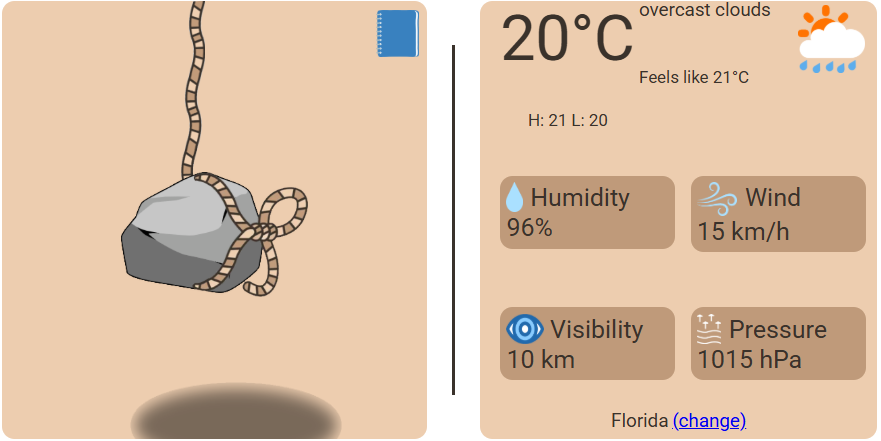

# weather-rock-extension
An extension where the weather rock tells you the weather (based on https://en.wikipedia.org/wiki/Weather_rock)

## Chrome Installation
1. Download the .zip file from https://github.com/swisstea4/weather-rock-extension/releases/download/v1.0.1/weather-rock-extension.zip
2. Extract the zip file.
3. Open Google Chrome and go to `chrome://extensions/`.
4. Enable developer mode using the switch at the top-right corner.
5. Click on the `Load unpacked` button.
6. Select the extracted extension folder containing `manifest.json`.
7. Click the Extensions icon (puzzle piece) in Chrome's toolbar and select Weather Rock to use it.

## Features
- Detects device location and shows current weather, including 
    - temperature
    - humidity
    - wind
    - visibility
    - pressure.
- Changes the state of the rock based on current weather (swinging rock if windy, wet rock if raining, etc.)

## Credits
- Weather data is provided by OpenWeather (https://openweathermap.org/)